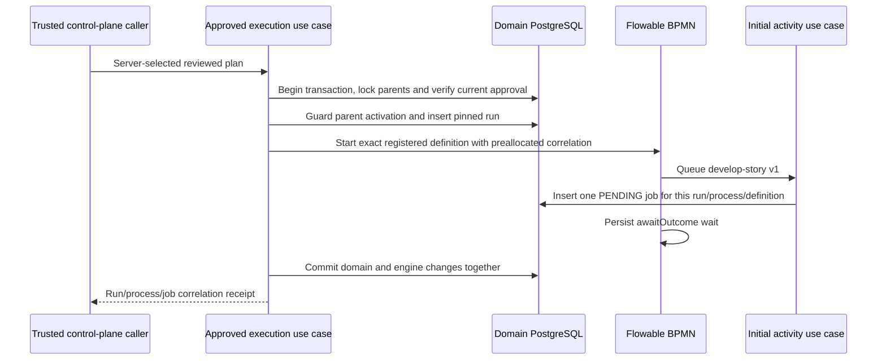

# Approved workflow and initial job

[#83](https://github.com/skizzay/forgeflow/issues/83) is the first delivery slice
of #47. It implements a trusted Java input port, not automatic event dispatch.
The second slice #84 will map verified inbox events into this port. There is no
HTTP start endpoint, poller, worker API, Docker action or GitHub write here.

## Ownership and transaction

`execution.application.port.in.StartApprovedExecution` accepts a server-selected
`ManualPlan`. It locks the epic, verifies the immutable human approval and exact
registered definition, then locks the configured story. The supported model is
one dependency-free story: the epic must contain exactly that child. `ManualPlan`
carries no dependency edges; multi-story/DAG plans are unsupported. This is not
a substitute for the later plan/dependency validator.

Current epic approval must equal the requested approval. Missing, invalidated or
mismatched pins deny startup. Existing lifecycle guards prepare the epic and
story as ACTIVE with audited transitions; the general lifecycle authority remains
deny-unverified. The narrowly scoped system actor is distinct from the original
human approver, whose verified identity/time are copied from approval evidence.

The service allocates opaque run/process/job IDs, persists the pinned run, and
starts Flowable by the exact registered engine definition ID. Flowable executes
the packaged service task, calls the `QueueInitialActivity` inbound port and
then persists its `awaitOutcome` receive-task wait. Java does not decide activity
order, complete the wait or choose a subsequent activity.

Run insertion, guarded parent state, audit, engine instance and initial job share
one imperative Spring transaction. Failures during dispatch or after engine
startup roll everything back. A surrounding caller must acknowledge only after
its outer transaction commits. No network/provider call happens under these locks.
Root locks serialize concurrent starts; `unique(story_id, approval_id)` and the
job's deterministic `initial:<run UUID>` idempotency key add database protection.
Restart/repeat calls return the existing correlation without starting another
process or job. Receipts are historical correlation, not proof of a live lease
or permission to execute. Workers will still need current ownership/approval guards.

## Packages, wiring and limits

The `execution` hexagon has framework-free domain values, application services
and input/output ports. It reuses lifecycle domain policies and transaction/repository
ports. JDBC and Flowable belong in separate adapters; the BPMN delegate depends
only on the activity input port. Configuration wires adapters and exposes only
the allowlisted delegate bean to engine expressions. No general Spring bean
registry or project-supplied expression is exposed to the engine.

`forgeflow.execution.enabled` defaults to false. Enabling it registers the packaged
`approved-story` workflow v1 and `develop-story` activity v1 (input/output contract
v1), validates existing content, and exposes the Java ports. It does not start
anything. Bootstrap registration remains unchanged when disabled. The run's
approval, configuration, workflow definition and activity versions are immutable.
A new version is required for changed registered content; there is no overwrite.

The initial job is an activity intent, not a runnable Codex assignment: payload,
image selection, capabilities, leases and worker claim/results are later slices.
Provider event authorization/correlation is not implemented by this port and must
precede it in #84. Manual approval of the bootstrap workflow is not approval of
this execution workflow. See [local use and verification](../user-guide/approved-execution.md).

Tests use PostgreSQL and the real embedded engine to verify required/revoked
approval, exact pins, parent guards, concurrent/restart deduplication, BPMN dispatch
and waiting, and rollback both during job insertion and after the engine has
returned. Architecture tests enforce a Java-only core and adapter dependency rules.
They do not establish inbox-triggered execution, live provider access or worker execution.
