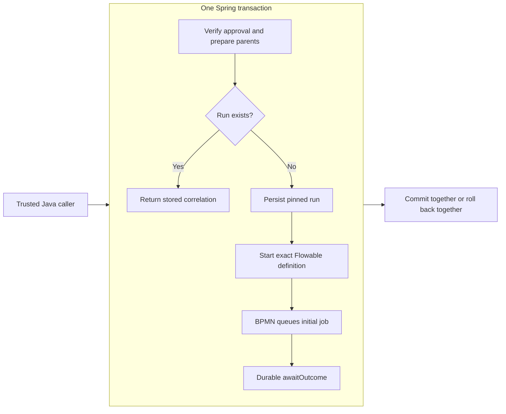

# Control-plane persistence bootstrap

Tracks [#7](https://github.com/skizzay/forgeflow/issues/7), parent
[Foundation #1](https://github.com/skizzay/forgeflow/issues/1). Consumes the accepted
[#18 research decision](https://github.com/skizzay/forgeflow/issues/18); no POC code
is adopted. [Documentation PR #26](https://github.com/skizzay/forgeflow/pull/26)
publishes the separate research record and category layout.

## Selected stack

Java 21, Spring Boot 4.0.9, Flowable OSS 8.0.0, PostgreSQL 17.11. Maven 3.9.9 is
provided by the development build container. Boot manages JDBC, Flyway and test
dependency versions. This advances the research stack deliberately: Flowable 8
requires Spring Framework 7 / Boot 4 and defaults to Jackson 3. Boot 4.0.9 is the
current patch in that compatible minor line; Boot 4.1 is not needed for this
bootstrap. PostgreSQL remains on the research major with current maintenance fixes.
Compatibility is tested here; these pins do not establish Pi capacity, legal
clearance or a complete security/deployment review. Re-evaluate patches before deployment.

Sources checked for this implementation:
[Flowable 8 release](https://github.com/flowable/flowable-engine/releases/tag/flowable-8.0.0),
[Boot 4.0 requirements](https://docs.spring.io/spring-boot/4.0/system-requirements.html),
[PostgreSQL maintenance policy](https://www.postgresql.org/support/versioning/).

## Ownership and transactions

One modular Spring Boot control plane uses one datasource and one Spring Boot auto-configured JDBC
transaction manager. `forgeflow` contains Flyway-managed domain tables, registry
metadata, pinned run identity, dispatch skeleton and webhook delivery metadata.
`flowable` contains engine-managed tables. The domain schema comes solely from
pgJDBC `currentSchema` in `FORGEFLOW_DB_URL`, for example
`jdbc:postgresql://db:5432/forgeflow?currentSchema=forgeflow`. The separate engine
schema remains configurable with `FORGEFLOW_ENGINE_SCHEMA` / runtime YAML
`forgeflow.database.engine-schema` (default `flowable`). Both are validated,
distinct dedicated lowercase identifiers; missing/multiple/current-public/system
schemas are rejected. The driver initializes every physical connection's search
path, equally for Hikari runtime connections and the standalone migrator.
At pool initialization, Hikari's default schema is also derived from that URI so
it restores the domain schema when Flowable temporarily changes a borrowed
connection's schema. This is not another user-configurable domain-schema setting.
Flowable 8 also changes schema on every command when its session factory has an
explicit schema. After startup validates the engine schema, runtime clears that
session-factory override while retaining qualified engine table SQL and engine
schema metadata. This prevents an engine call from changing the search path in
the shared domain transaction. Regression tests cover unqualified domain writes
alongside engine operations and pool borrowing. Recheck this Flowable integration
point on engine upgrades.
Flyway creates/manages the configured schemas and default schema explicitly;
domain migration SQL and registry queries use unqualified names. No SQL schema
placeholder or independent domain-schema setting remains. Changing the URI selects
a different schema; it does not rename or move existing data.
There are no cross-schema foreign keys
into engine internals; engine IDs are opaque correlation values. The registry
uses a composite foreign key so a run's key/version cannot name another engine definition.

A run is unique for its `(story_id, approval_id)` pair. PostgreSQL rejects a
second run even when its run and engine-instance IDs differ; a new approval ID
is a different identity. This is database protection, not an enqueue operation
or permission to retry work. The bootstrap PostgreSQL test verifies both cases.

Starting a workflow and storing its domain correlation must use the same Spring
transaction. A PostgreSQL-backed rollback test demonstrates both writes roll back
together. Bootstrap registration is serialized with a transaction-scoped advisory
lock and deploys the packaged side-effect-free workflow once; content mismatch or
a missing registered definition fails startup. A version change must use a new
registry version, never overwrite an existing registered definition.

The bootstrap has no run-start endpoint, scheduler or worker claim/completion API.
The opt-in [manual approval command](manual-plan-approval.md) records one configured
human approval through existing lifecycle guards; it starts no workflow. Its packaged process waits at a receive task and has no
side effects. The restart test creates a clearly marked approval fixture, deploys
a second definition, and verifies the original run and stored plan/config/approval
identity remain unchanged. That is persistence evidence, not authorization enforcement.
No job update implicitly marks a story merged. #14 owns guarded domain transitions;
#9/#15 own lease/fencing/recovery policy, and #8 owns verified inbox ingestion.
Schema states are a constrained initial vocabulary, not those completed behaviors.

## Execution intent persistence

The `execution` feature provides the framework-free `ExecutionRun` correlation
value and `ExecutionStore` outbound port, implemented by `JdbcExecutionStore`
(#95). Storage itself starts no Flowable process or parent lifecycle transition;
Spring composition wires it into the approved starter and initial-activity handler.

The adapter copies exact immutable manual-approval and registered-definition pins,
including the original approver and approval timestamp, into a run. Initial job
intent is bound to the run/process/definition tuple and a registered activity,
with the unique key `initial:<run UUID>`. Lookup returns only matching pins with
a complete initial-job correlation; conflicting or partial records fail closed.
Duplicate writes are command conflicts; other database failures are reported as
storage unavailable without exposing SQL through the port.

This storage port is not approval authority. Its caller must verify current
approval through `PrepareApprovedStory`, hold root-to-leaf parent locks and invoke
all writes inside the same outer transaction as engine startup. The adapter joins
the caller's transaction. The approved starter below supplies that boundary;
repository-specific workflow selection remains #93. PostgreSQL tests verify exact
stored pins, reload, mismatch rejection, uniqueness and rollback of run/job together, without claiming engine dispatch.

## Approved execution startup

`forgeflow.execution.enabled` defaults to false. When enabled, startup registers
packaged `approved-story` v1 / `develop-story` v1 and exposes the trusted Java
`StartApprovedExecution` port (#89). Registration alone starts no process or job.
Content/contract mismatches still fail startup; restart never overwrites a definition.
This single-workflow scope does not implement repository-specific selection (#93).

`ApprovedExecutionService` joins `PrepareApprovedStory` inside one outer imperative
transaction, retaining root-to-leaf locks until commit. Preparation verifies current
and immutable approval and activates the matching parents through lifecycle guards.
An existing pinned run returns its stored correlation without another engine start.
Otherwise, an injected UUID supplier allocates run/process/job identities, the store
copies the approved pins, and the Flowable adapter starts that exact definition.

BPMN invokes `ApprovedActivityDelegate` through the engine's explicit bean allowlist.
The delegate calls `QueueInitialActivity`; `InitialActivityService` persists the
initial PENDING `develop-story` v1 job in the same transaction. BPMN then enters
`awaitOutcome`. Neither the starter nor worker transport is a Java activity router.
The core depends on lifecycle ports, never its adapters; Spring configuration wires
JDBC, transaction and Flowable implementations. Engine types stay in adapters.

PostgreSQL tests verify concurrent starts yield one run/job/process, restart replay,
revoked/mismatched approval denial, and rollback of parent states, audit, run, job
and engine records during dispatch and after engine startup. Runtime remains opt-in
and has no start HTTP endpoint, inbox trigger (#84), worker execution or publication.
Future WebFlux callers must execute the entire imperative operation off event-loop
threads. A returned correlation inside a larger transaction is acknowledged only
after its caller commits. Worker completion/progression remains separate work.

## Schema initialization

ForgeFlow is developing its initial release. One V1 migration defines the current
domain schema, including verified webhook identity and guarded lifecycle state.
There is no supported upgrade path between development revisions. Initialize a
fresh disposable development database after changing V1; preserve any needed data
before recreating it. The application does not repair history or delete data.

Runtime uses Flowable schema-update `false` and Flyway validation only. Missing or
incompatible tables/checksums stop startup. The separate `-migrate.jar` executable
runs Flyway first, then Flowable schema maintenance and exits. It uses no Spring
application context, HTTP server or workflow registration. Run it before starting
runtime, using a migration identity with DDL privileges. Runtime needs schema
USAGE and table DML/sequence privileges, not DDL. Initialization must be serialized
across the entire Flyway-plus-engine command; those steps are not one transaction.
No automatic clean, baseline, repair or application-startup DDL is enabled.

The development Compose database uses a disposable local administrator. Do not
reuse that identity/password for deployment. Provision deployment roles separately;
the integration test also verifies runtime startup with a DML-only identity.
Supported release upgrades, blue-green coexistence and data conversion are outside
the initial-release contract.

## HTTP and deployment boundary

Runtime uses Spring WebFlux/Reactor Netty and reactive Spring Security, and binds
to loopback by default. JDBC/Flowable remain imperative/blocking and share Boot’s
JDBC transaction manager. Application-owned request persistence runs on bounded elastic threads; Actuator
adapts the JDBC health contributor for reactive execution. Future HTTP
handlers must delegate the whole imperative transaction to a bounded blocking
executor (for example `Mono.fromCallable(...).subscribeOn(Schedulers.boundedElastic())`),
never block a Netty event loop or span a JDBC transaction across reactive hops.
No R2DBC conversion is implied. Runtime binds to loopback by default. Only GET `/actuator/health` is public, with
status only; other routes are denied except explicitly enabled HMAC webhook ingress and the
OAuth2-protected manual approval routes. The optional [verified webhook ingress](webhook-inbox.md) is implemented in #8;
worker and other GitHub routes do not exist yet.
The local Docker command binds inside its container and publishes only host loopback.
No external identity service, tunnel or Docker host socket is configured. The
execution plane remains a separate Java controller and isolated job containers.
