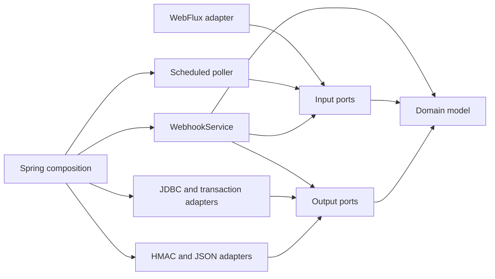

# Hexagonal control-plane structure

Tracks [#8](https://github.com/skizzay/forgeflow/issues/8) in
[PR #23](https://github.com/skizzay/forgeflow/pull/23). The webhook feature provides
the first ports-and-adapters application core in the control plane.

## Dependency direction

Business rules and use cases depend on Java and core contracts. They have no
Spring annotations, HTTP status codes, Reactor types, SQL, Jackson types or
scheduler dependencies. Framework configuration creates concrete adapters and
injects them into the use case. Existing application entry, schema/migration setup
and packaged workflow initialization remain infrastructure at the control-plane
composition boundary.

The arrows below show source-code dependencies, not execution order:

| Package under `webhook` | Responsibility |
|---|---|
| `domain` | Delivery identity, validated metadata, classification, receipt and typed failures |
| `application` | Authenticate before decode/store; duplicate/conflict policy; classify and complete pending work |
| `application.port.in` | `ReceiveWebhook` and `ProcessWebhook` entry points; immutable signed input |
| `application.port.out` | Repository, transaction, signature-verification and payload-decoding contracts |
| `adapter.in.http` | Body bounds, headers/media handling, bounded-elastic execution and HTTP error mapping |
| `adapter.in.scheduling` | Poll timing, bounded batches and safe failure logging |
| `adapter.out.persistence` | SQL, row locks, JSONB persistence and Spring transaction implementation |
| `adapter.out.security` | JDK SHA-256 HMAC with the configured signing secret |
| `adapter.out.json` | Jackson/GitHub payload decoding into typed allowlisted metadata |
| `configuration` | Spring properties, conditional enablement and concrete dependency wiring |

## Transaction and error contracts

The application explicitly requests `TransactionBoundary.required`. The persistence
adapter implements it using the existing Spring transaction manager. Receive does
insert-if-absent plus identity comparison in one transaction. Process claims a
verified row, chooses its domain classification, publishes it and marks completion
in one transaction. Repository locks remain held until that boundary finishes;
the PostgreSQL adapter uses `FOR UPDATE SKIP LOCKED`. These atomicity requirements
belong to the port contract and must be preserved by any replacement adapter.

Adapters translate database/transaction failures into a core storage-unavailable
failure without carrying raw SQL or payload details. The HTTP adapter maps core
failures to 401/400/409/503. The core never chooses an HTTP response. The poller
uses the processing input port and cannot reach JDBC directly.

`WebhookMetadata` is typed and validated; it contains no arbitrary JSON or raw
payload. Serialization happens in the persistence adapter. Signature verification
and JSON decoding are replaceable output ports, while their ordering and the
requirement to authenticate before parsing remain application policy. Signed input
defensively copies payload bytes and redacts its string representation.

## Verification and evolution

Architecture tests inspect compiled production classes with ArchUnit and enforce:

- Domain and application depend only on Java and their own core packages.
- Domain cannot depend on application; ports cannot depend on implementation classes.
- Adapters cannot depend on Spring composition or concrete application service.
- Inbound and outbound adapters cannot depend on each other.

Framework-free use-case tests exercise authentication-before-storage, replay
conflicts, duplicate acknowledgement, required routing identity and classification.
The existing PostgreSQL/HTTP suite continues to verify concrete adapters,
transactions, concurrent delivery, rollback, restart and scheduling. No schema,
endpoint, configuration-key or acknowledgement contract changes are introduced
by this refactor. This is package-level separation inside the current Maven
module; an additional deployment or Maven module is not needed for these boundaries.

Apply the same dependency direction to future worker and orchestration features.
Keep repository/SCM provider concerns behind outbound ports and human approval,
idempotency and state-transition policy in their application/domain core.

The [lifecycle feature](lifecycle-states.md) follows the same core/port/adapter
direction. Its authority adapter defaults to deny-unverified; transition policy
belongs to its job/story/epic domain entities and focused domain policies;
transaction and replay orchestration stay in the framework-free application core.
