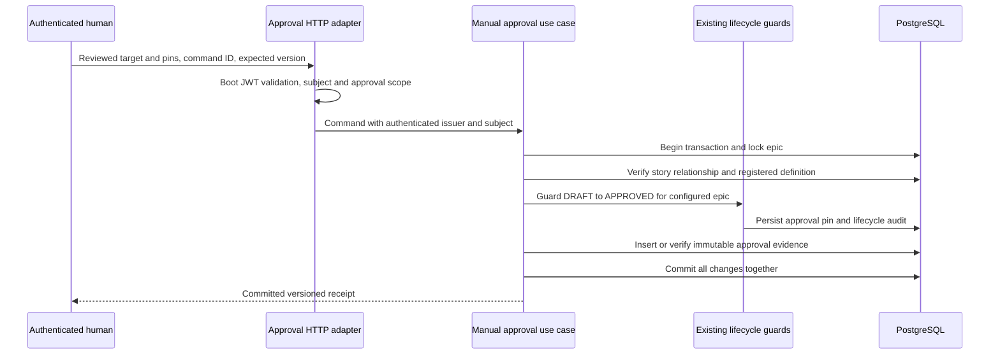

# Configured manual plan approval

Implements [#46](https://github.com/skizzay/forgeflow/issues/46), under #11/#3.
The opt-in command records human approval for one configured epic/story pair. It
transitions only the epic DRAFT → APPROVED, or APPROVED → DRAFT on invalidation.
The story stays DRAFT. No workflow instance, job, dispatch or merge is created.
The [approved execution backend](approved-execution.md) consumes current evidence
and uses the guards for parent activation/readiness. Event routing into that
backend remains #84 under #47; the approval command itself never starts execution.

## Authentication and authority

Spring Boot owns JWT decoder configuration through standard resource-server
properties, shared with the worker boundary. An external identity provider owns
human login and issues the operator's access token. Both the configured subject
and `forgeflow.plan.approve` scope are required, as are the trusted issuer,
audience, signature and timestamps. Tokens without expiry are denied. Worker
scope alone confers no approval authority; worker clients must not be granted
the human subject or approval scope by the provider.

The operator chain covers only the plan-approval path and descendants. It is
stateless and bearer-only; CSRF is disabled only for this chain. Other routes
retain their existing security policies. The audited actor is the validated
issuer, a space, and subject, keeping the identity scoped to its issuer. It never
comes from request JSON. Unknown outer request fields, including `actorId`, are
rejected. The external provider must reserve the configured subject for a human;
ForgeFlow does not build a login service or infer human authority from labels.

## Core and transaction

The existing lifecycle hexagon contains a small `ManualPlan` value,
`RecordManualApproval` inbound port, `ManualApprovalService` application service
and `ManualApprovalStore` outbound port. The WebFlux controller uses only the
inbound port and runs its whole imperative transaction on bounded elastic
threads. Spring composition wires JDBC/transaction adapters and security.

The use case compares the requested target, approval identity and workflow
key/version/content hash against server-selected configuration. Under the epic
lock it verifies the story belongs to that epic and resolves the exact registered
workflow definition. Its private lifecycle service supplies narrowly scoped
human authority for this epic only. The general lifecycle authority remains
`DenyUnverifiedAuthority`; this feature cannot authorize arbitrary transitions.

`manual_plan_approval` records the approval ID, epic/story, plan revision,
configuration digest, exact workflow key/version/engine definition/content digest,
verified actor and first approval time. No update/delete API exists. Epic pin,
audit and evidence commit atomically; storage failure rolls them all back.
A reused approval ID cannot change its stored identity or target.

Invalidation clears the epic's current pin through the existing lifecycle guard;
historical evidence and audit remain. The audit and immutable evidence must bind
invalidation (including replay) to the originally approved epic/story target. Active work cannot be reset to DRAFT through
this command. Changed configured inputs cannot silently replace a pin: explicitly
invalidate while APPROVED, then approve the newly reviewed identity with a new
command ID and current expected version. Use a new approval ID for changed pins.
Identical actor-bound command replay returns its historical receipt, not current
state, and cannot reactivate an invalidated approval. Future dispatch must re-read
current pins rather than trust an old receipt.

## Limits and verification

This is a manual single-pair facility, not a plan parser, DAG/dependency validator,
configuration resolver or general authority integration. The configuration digest
is supplied for a snapshot reviewed out of band; this feature does not compute
it from project files. Definition content is checked against the trusted registry.
No remote calls occur inside the approval transaction. Flowable still owns later
process progression; approval does not advance the packaged waiting process.

PostgreSQL and real HTTP/JWT tests cover subject/scope separation, body identity
rejection, exact persisted pins, actor-bound replay across restart, configuration
change/invalidation, active-state rejection, competing approval, transactional
rollback and absence of dispatch. Architecture tests retain the framework-free
core and adapter boundaries. Live IdP login, TLS and workflow dispatch are not
established by those tests. See the [operator guide](../user-guide/manual-plan-approval.md).
