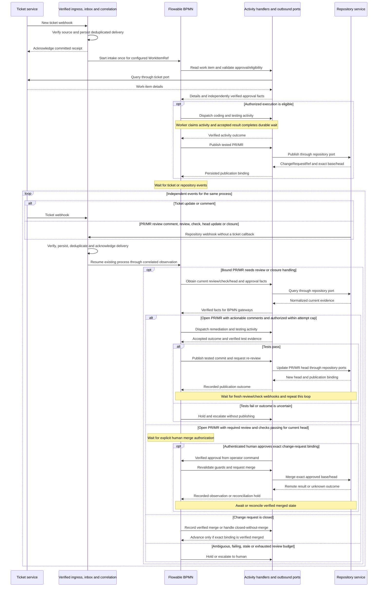
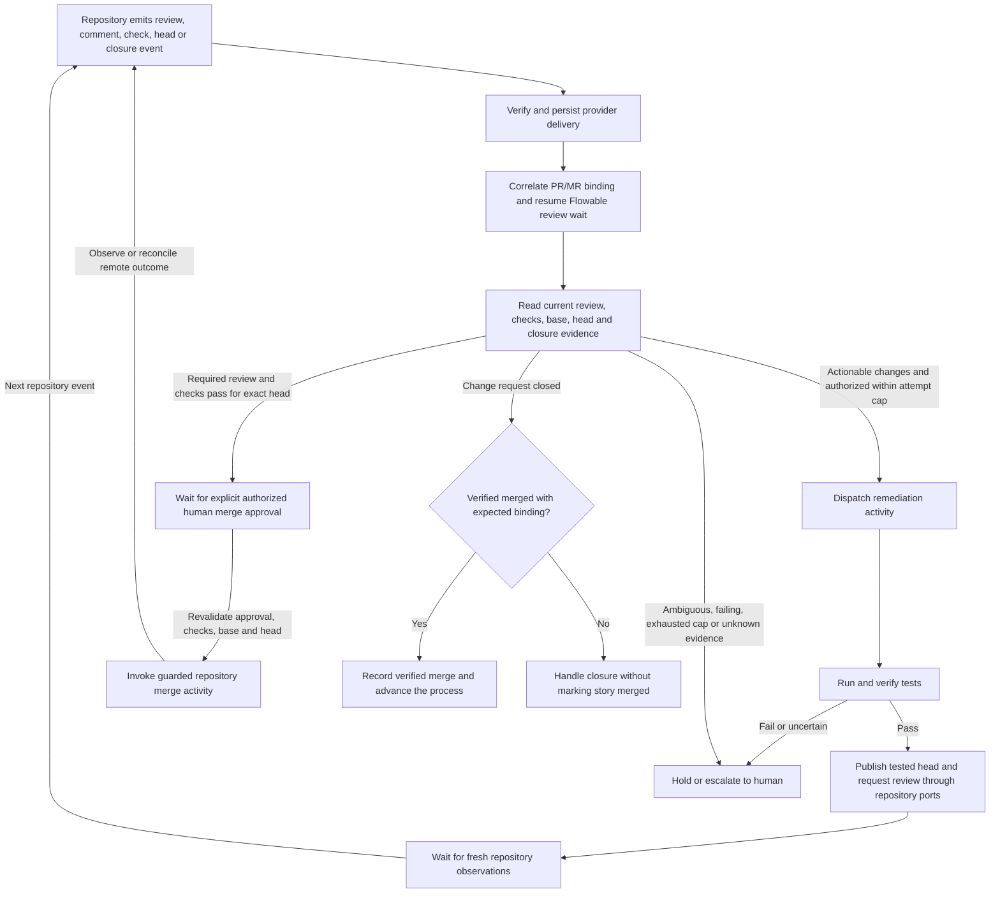

# Flowable and provider boundaries

Target design for [#77](https://github.com/skizzay/forgeflow/issues/77).
The [worker protocol](../requirements/worker-protocol.md) is the execution-plane
contract within this design, not the workflow definition or provider API.

## Responsibility and implementation status

| Responsibility | Owner | Current status |
|---|---|---|
| Activity order, gateways, durable waits and business retry paths | Flowable BPMN | Bootstrap waits at `awaitImplementation`. The optional approved-story definition is registered, with runtime dispatch binding pending #89; production story execution is not implemented. |
| Approval authority, attempt ownership, leases, fencing and verified evidence | Focused Java domain policies and activity handlers | Lifecycle guards, OAuth2 worker authentication and single-pair manual human approval exist; worker operations and process dispatch remain unimplemented. |
| Job/story/epic transition model | Java lifecycle domain | Implemented today; must not grow into a parallel workflow sequencer. Independent business invariants remain, while BPMN owns process routing. |
| Event ingestion and process correlation | Inbound adapters plus durable inbox and Flowable entry handlers | GitHub inbox verification/classification exists; normalized process-start/resume integration is proposed. |
| Ticket operations | Ticket ports and provider adapters | Proposed; no provider-neutral ticket port is implemented. |
| Repository/change-request operations | Repository ports and provider adapters | Proposed; current GitHub-specific schema and webhook code are not a pluggable repository implementation. |

Do not infer a production orchestration path from the presence of Flowable or a
successful Java state transition. Review the existing lifecycle responsibilities
against this boundary before extending story/epic progression.

## Ticket and source-repository ports

Tickets and repositories are separate integrations, even when both use GitHub.
A Jira work item may target a GitLab repository without a combined Jira/GitLab
adapter. Provider selection is trusted server configuration, not worker input.

| Boundary | Minimum activity-facing capability | Provider-neutral result |
|---|---|---|
| Ticket query | Read a work item and its linked references | Work-item details/acceptance input; plan validation remains ForgeFlow policy |
| Repository query | Read branch/head, change request and check observations | Exact normalized refs, commit identities and evidence, including unknown state |
| Branch/commit publication | Publish or confirm the expected branch/commit | Bound branch and commit identity |
| Change-request publication | Publish or confirm a request for the expected base/head | `ChangeRequestRef` and exact binding |
| Change-request merge | Request merge only for the approved exact base/head under mandatory checks and human authority | Verified merged identity, or explicit failure/unknown outcome |

These are small outbound ports required by specific activities, not a mandatory
single interface covering every provider API. GitHub adapters implement the first
concrete integration. Other adapters must explicitly report unsupported required
capabilities; an absent review/check capability must never be treated as passed.
Provider payloads, credentials, SDKs, webhook signatures and status translation
stay in adapters. Provider status or ticket labels do not grant human approval.

`WorkItemRef` and `RepositoryRef` each contain `integrationId` (configured UUID)
and `externalId` (nonempty opaque string, at most 256 characters). They may use
different integrations. `ChangeRequestRef` belongs to a `RepositoryRef` plus its
opaque request ID; `BranchRef` belongs to a repository plus its branch name.
A GitHub number alone is not a global identity. Do not parse provider meaning
from an external ID or use display URLs as credentials or authority.

## Event-driven process entry and continuation

A configured ticket service emits the initial new-ticket event. After a change
request is published, the repository service independently emits PR/MR, review,
comment, check and head-update events; no ticket update is required to progress.
Each provider's inbound adapter verifies its source and persists a deduplicated
delivery before acknowledgement.
Asynchronous processing normalizes the event and correlates it to a work item
and process. It starts a configured intake process once for eligible new work,
or resumes the existing process for later events. Flowable decides whether to
wait, request approval, dispatch an activity, handle review or finish the process.
A new ticket starts intake, not automatic approval or coding.

Inbound event adapters and outbound ticket/repository ports are separate
boundaries. Normalization translates provider payloads into trusted observations;
correlation locates the process. Neither is a Java workflow router. A registered
Flowable event entry point receives the observation; BPMN gateways and waiting
activities determine its business effect. Unknown events may be recorded/ignored,
and unmatched or uncertain events held for reconciliation; do not start a new
execution process for each delivery. There is no dynamically supplied BPMN name
or arbitrary signal target in an external event.

This is the proposed event cycle, not an executable BPMN definition. The PR/MR
review-comment path, remediation, tested head publication, re-review and guarded
merge are shown explicitly in this sequence. A merge reply alone is not proof of
completion; verified merged state is required. Ticket-only events with no review
binding remain in intake/approval handling rather than invoking review activities. The worker
claim/heartbeat/result sequence is a zoom-in on one execution activity selected
by that process, not the system's entry point. Accepted worker results and trusted
operator commands also enter the correlated process through application handlers;
they do not require a provider webhook.

| Incoming observation | Correlation and Flowable responsibility |
|---|---|
| New ticket | Start one eligible intake process for the configured integration/work-item identity; validate approval before dispatch. |
| Ticket update/comment | Resume that work item's process; inspect changed inputs/authorized approval, invalidate stale execution eligibility or keep waiting as appropriate. A comment/label alone is not approval. |
| Change-request review/comment | Resume the existing review wait through the stored repository/change-request binding. BPMN may dispatch authorized bounded remediation or escalate ambiguity. No ticket event is required. |
| Check/review/head update | Re-evaluate eligibility for that exact head. Changed head invalidates stale checks/review/merge authorization; passing review alone does not authorize merging. |
| Change request closed | Verify exact repository/base/head and merged status through the repository port. Closed without merge must not mark the story MERGED. |

## Repository-driven review and merge

Once a PR/MR is bound to the process, repository events are an independent
catalyst. The configured repository integration plus `ChangeRequestRef` locates
the process directly; correlation does not wait for a ticket-system callback.
The following is a proposed later-milestone BPMN review loop, not implemented
behavior or permission to merge in the first vertical slice.

Remediation uses the existing worker activity path and preserves its approval,
lease and fencing guards. Default cap is two remediation attempts; publishing a
new head must not reset the budget. Failed tests cannot enter the publish/merge
path. Re-review/check events resume the wait again; they do not create new story
processes. Deduplicate comments and observations across delivery/reconciliation
so replay cannot consume another attempt or repeat a merge.

A review may make a change eligible for merging, but does not grant merge
authority. Human approval is a separate authenticated command bound to the exact
repository/change-request/base/head; revalidate it and required evidence at the
merge boundary. Unsupported provider checks/review/merge capabilities, changed
heads and unknown outcomes hold the workflow. A merge request is not proof of a
merge: record completion only from verified provider state. Existing epic and
final epic-to-main human approval gates remain mandatory.

Persist the process/work-item and publication bindings. Duplicate events must not
start another process or repeat an accepted effect. Provider deliveries can arrive
late or out of order: an old observation cannot override a newer accepted state;
when ordering/state is uncertain, query the authoritative provider and reconcile.
Keep events that arrive before their local binding is committed available for
later correlation. Inbox consumption and engine/domain changes must commit
atomically, or retain a durable retryable handoff; acknowledging a webhook is
not proof that Flowable has processed it. No volatile notification alone suffices.

The worker does not advance BPMN, query tickets through the control-plane ports,
or select its next activity. Its `execution` pins correlate an assigned activity
with the waiting process; they do not expose engine APIs. Activity input contains
only the resolved data needed for that activity, rather than raw provider payloads.
Trusted publication code may run in the control plane or trusted controller;
untrusted job containers never receive broad provider credentials or host sockets.

Accepted job completion and the matching Flowable wait completion use the same
Spring transaction (#70), with explicit duplicate correlation. Remote repository
operations are outside that database transaction. If publication succeeds but
local recording fails, reconcile the exact remote binding before another attempt.
No database rollback can undo a remote commit/PR. Keep no database lock open while
waiting for a container or provider network operation.

Flowable owns waits, timers and retry routing. Java supplies verified recovery
facts and enforces mandatory guards. Expiry first invalidates execution ownership;
unknown external effects keep the process waiting. Only a BPMN path guarded by
current approval and verified quiescence can dispatch another attempt. Worker
transport retries repeat the same command; they do not start another workflow
activity. Authorized cancellation must stop execution and notify the matching
process without enabling a competing Java activity sequencer.
