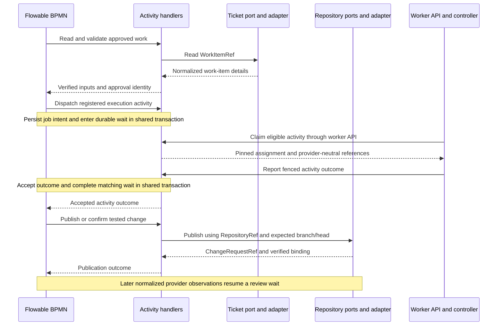

# Flowable and provider boundaries

Target design for [#77](https://github.com/skizzay/forgeflow/issues/77).
The [worker protocol](../requirements/worker-protocol.md) is the execution-plane
contract within this design, not the workflow definition or provider API.

## Responsibility and implementation status

| Responsibility | Owner | Current status |
|---|---|---|
| Activity order, gateways, durable waits and business retry paths | Flowable BPMN | Embedded engine exists; packaged process only waits at `awaitImplementation`. Production story workflow is not implemented. |
| Approval authority, attempt ownership, leases, fencing and verified evidence | Focused Java domain policies and activity handlers | Lifecycle guards exist; worker transport and production authority integrations do not. |
| Job/story/epic transition model | Java lifecycle domain | Implemented today; must not grow into a parallel workflow sequencer. Independent business invariants remain, while BPMN owns process routing. |
| Ticket operations | Ticket ports and provider adapters | Proposed; no provider-neutral ticket port is implemented. |
| Repository/change-request operations | Repository ports and provider adapters | Proposed; current GitHub-specific schema and webhook code are not a pluggable repository implementation. |

Do not infer a production orchestration path from the presence of Flowable or a
successful Java state transition. Review the existing lifecycle responsibilities
against this boundary before extending story/epic progression.

## Ticket and source-repository ports

Tickets and repositories are separate integrations, even when both use GitHub.
A Jira work item may target a GitLab repository without a combined Jira/GitLab
adapter. Provider selection is trusted server configuration, not worker input.

| Boundary | Minimum activity-facing capability | Provider-neutral result |
|---|---|---|
| Ticket query | Read a work item and its linked references | Work-item details/acceptance input; plan validation remains ForgeFlow policy |
| Repository query | Read branch/head, change request and check observations | Exact normalized refs, commit identities and evidence, including unknown state |
| Branch/commit publication | Publish or confirm the expected branch/commit | Bound branch and commit identity |
| Change-request publication | Publish or confirm a request for the expected base/head | `ChangeRequestRef` and exact binding |

These are small outbound ports required by specific activities, not a mandatory
single interface covering every provider API. GitHub adapters implement the first
concrete integration. Other adapters must explicitly report unsupported required
capabilities; an absent review/check capability must never be treated as passed.
Provider payloads, credentials, SDKs, webhook signatures and status translation
stay in adapters. Provider status or ticket labels do not grant human approval.

`WorkItemRef` and `RepositoryRef` each contain `integrationId` (configured UUID)
and `externalId` (nonempty opaque string, at most 256 characters). They may use
different integrations. `ChangeRequestRef` belongs to a `RepositoryRef` plus its
opaque request ID; `BranchRef` belongs to a repository plus its branch name.
A GitHub number alone is not a global identity. Do not parse provider meaning
from an external ID or use display URLs as credentials or authority.

## Proposed activity interaction

The following is a responsibility diagram, not an executable BPMN definition.
Each activity is implemented by a focused application handler. Flowable chooses
which activity follows an accepted outcome; the handler calls its required ports.

The worker does not advance BPMN, query tickets through the control-plane ports,
or select its next activity. Its `execution` pins correlate an assigned activity
with the waiting process; they do not expose engine APIs. Activity input contains
only the resolved data needed for that activity, rather than raw provider payloads.
Trusted publication code may run in the control plane or trusted controller;
untrusted job containers never receive broad provider credentials or host sockets.

Accepted job completion and the matching Flowable wait completion use the same
Spring transaction (#70), with explicit duplicate correlation. Remote repository
operations are outside that database transaction. If publication succeeds but
local recording fails, reconcile the exact remote binding before another attempt.
No database rollback can undo a remote commit/PR. Keep no database lock open while
waiting for a container or provider network operation.

Flowable owns waits, timers and retry routing. Java supplies verified recovery
facts and enforces mandatory guards. Expiry first invalidates execution ownership;
unknown external effects keep the process waiting. Only a BPMN path guarded by
current approval and verified quiescence can dispatch another attempt. Worker
transport retries repeat the same command; they do not start another workflow
activity. Authorized cancellation must stop execution and notify the matching
process without enabling a competing Java activity sequencer.
