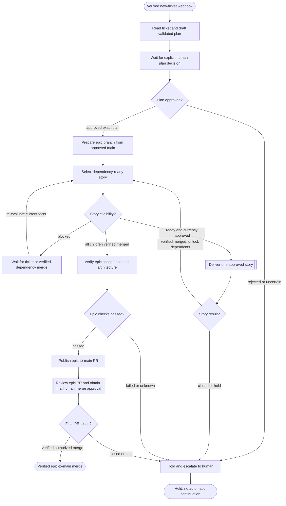
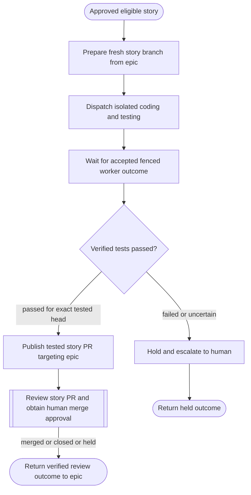
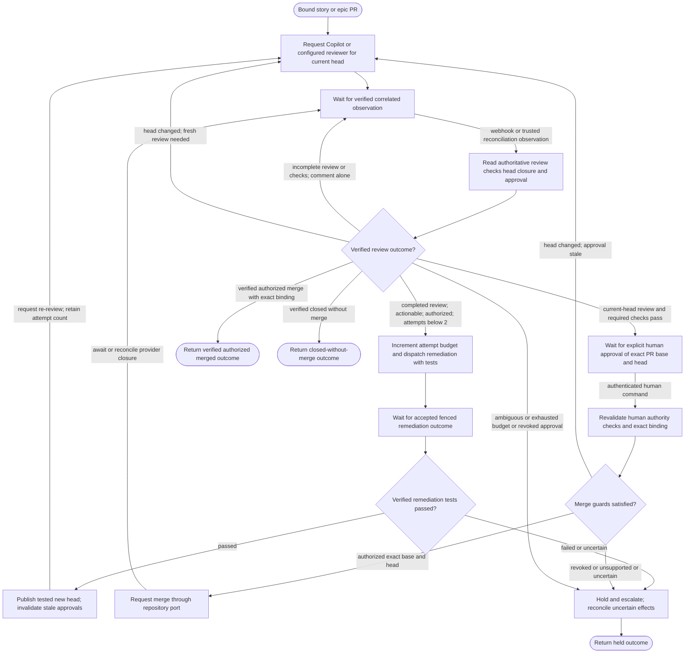

# Development workflow reference

Tracks [#100](https://github.com/skizzay/forgeflow/issues/100).
[Download/open the BPMN model](workflows/development-lifecycle.bpmn20.xml).

**Proposed architecture reference, not an executable workflow.** All three BPMN
processes have `isExecutable="false"`; the file lives outside runtime resources
and is never registered by ForgeFlow. Tasks, decisions and call outcomes describe
required responsibilities, not implemented delegates, expressions or IO mappings.
The embedded BPMN diagram coordinates are a basic layout, not a polished rendering.

The Mermaid views below use the same node IDs, edge labels and sequence flows as
the BPMN processes. A call activity invokes the named reference process; it does
not create another unrelated ticket process. The review/merge process is shared
by story-to-epic and epic-to-main PRs, with their distinct human approval bindings.

## Epic coordination



## Story delivery



## Repository review and merge



## Events, authority and recovery

- Ticket/repository adapters verify and durably deduplicate webhooks before
  acknowledgement. Correlation uses integration, work item, repository, PR and
  exact reviewed head; events never supply arbitrary BPMN targets or authority.
- A completed Copilot review resumes the existing review wait through a normalized
  observation. Individual comments are retained/deduplicated but do not imply
  review completion. Repository review, check, head and closure events progress
  independently of ticket callbacks. Reconciliation may supply the same trusted
  observations when a webhook is late or missing.
- Worker waits receive authenticated, fenced, accepted results. Failed or unknown
  test outcomes cannot publish code. Current plan approval, dependencies, ownership
  and cancellation must be checked again at dispatch and publication boundaries.
- Two remediation attempts is the default maximum across the PR's review cycles;
  publishing a new head or requesting another review never resets that count.
  Only actionable completed review evidence for the current head permits dispatch.
- Review/check success is eligibility, not merge authority. A separate authenticated
  human approves the exact repository/PR/base/head; guards are revalidated before
  a merge request. New heads invalidate old review/check/merge approval evidence.
  Only independently verified, authorized merged state returns a merged outcome.
- Call outcomes are `merged`, `closed` or `held`. Story dependencies unlock only on
  verified merge into the epic. Epic acceptance/architecture checks and a separate
  final human merge approval guard epic-to-main integration.
- Database inbox/engine/domain handoffs are atomic or durable/retryable. Remote
  publication and merge effects require idempotency and reconciliation; a database
  rollback cannot undo them. No database locks span worker/provider waits.
  Hold paths stop automatic dispatch and require human/recovery handling; they do
  not claim containers or remote effects have already stopped. Detailed lease,
  cancellation, timer and recovery subflows are intentionally not expanded here.

## Current implementation and verification

Verified ingress/classification, lifecycle guards, manual approval and the opt-in
atomic approved-story starter exist. That packaged process only queues its first
job and waits. The intake, planning/DAG scheduling, worker execution, publication,
review webhook loop and final integration above span later roadmap work and are
not delivered by this reference. #84 owns the next inbox-to-starter integration;
#93 owns repository-specific workflow configuration. See the
[provider/workflow boundaries](workflow-boundaries.md) and
[persistence guide](control-plane-persistence.md#approved-execution-startup).

Run the structural/schema checks with the project's Java build container:

```sh
docker compose -p forgeflow-reference-check run --rm build mvn -B -Dtest=WorkflowReferenceTest -Dsurefire.failIfNoSpecifiedTests=false test
```

Remove only that disposable verification project after the check:

```sh
docker compose -p forgeflow-reference-check down --volumes --remove-orphans
```

The check validates BPMN XML against Flowable's bundled BPMN schema, resolves
sequence/call references, checks diagram coverage, and compares Mermaid nodes,
labels and edges. Mermaid syntax is also parsed during this change's verification.
These checks establish document consistency, not executable process behavior or
visual readability in every BPMN editor. No reference process is deployed.
