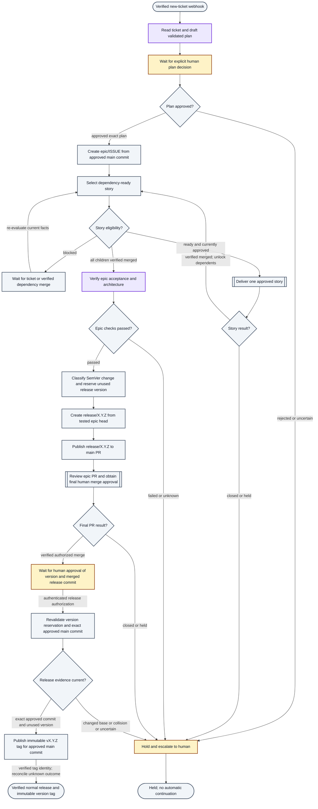
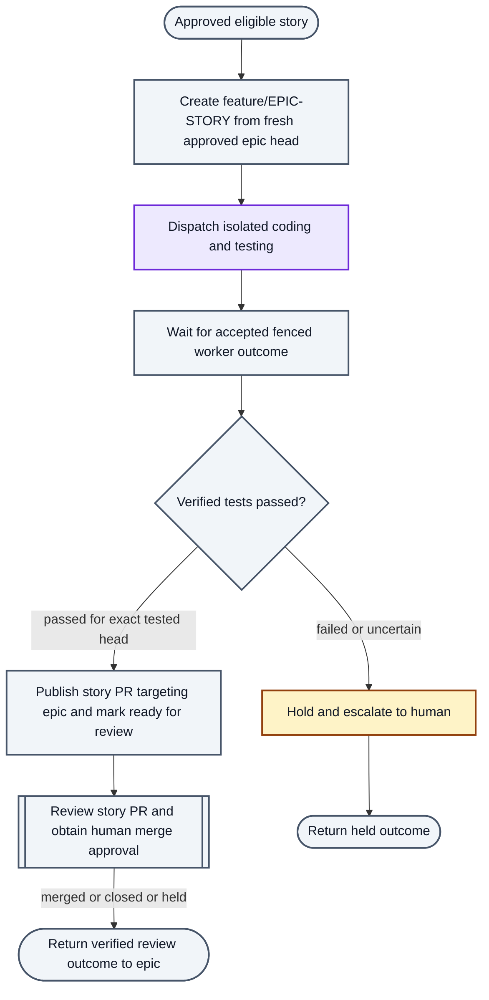
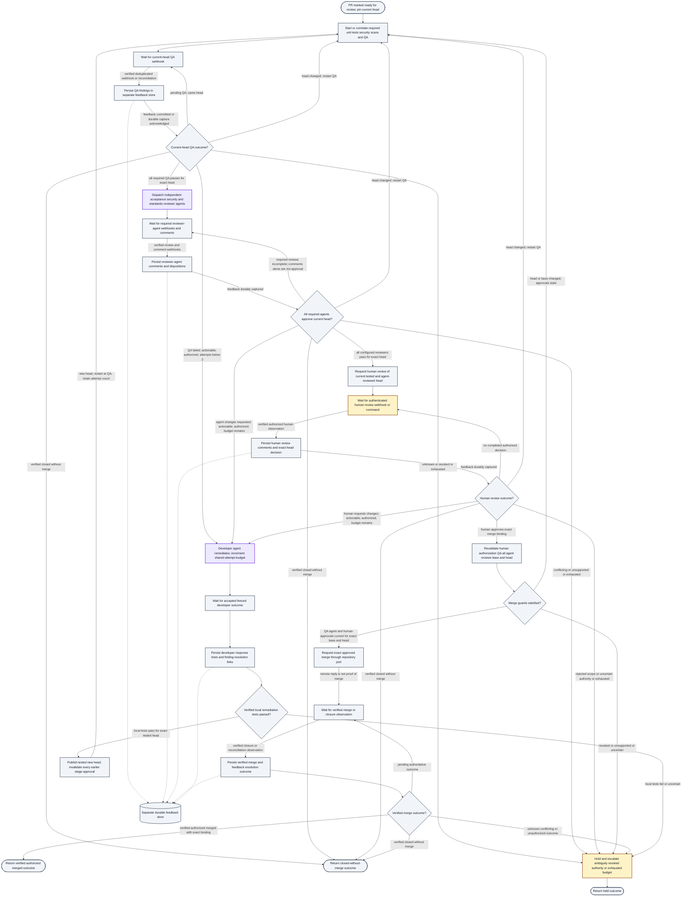
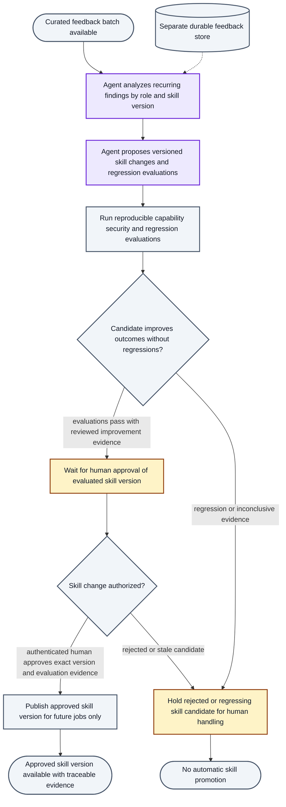

# Development workflow reference

Tracks [#100](https://github.com/skizzay/forgeflow/issues/100).
[Download/open the BPMN model](workflows/development-lifecycle.bpmn20.xml).

**Proposed architecture reference, not an executable workflow.** All five BPMN
processes have `isExecutable="false"`; the file lives outside runtime resources
and is never registered by ForgeFlow. Tasks, decisions and call outcomes describe
required responsibilities, not implemented delegates, expressions or IO mappings.
The BPMN includes a routed layout with orthogonal connectors and explicit labels.
It contains five diagrams; viewers that open only the first show epic coordination.
Select the story, review, hotfix or skill-improvement diagram to inspect each view.
BPMN colors use the common bpmn.io `bioc` extension; viewers without color support
can still display the standard shapes and labels.

The Mermaid views below use the same node IDs, edge labels and sequence flows as
the BPMN processes. A call activity invokes the named reference process; it does
not create another unrelated ticket process. The review/merge process is shared
by story-to-epic, release-to-main and hotfix-to-main PRs, with distinct approval bindings.
The [main-only GitFlow and versioning contract](../requirements/branching-and-versioning.md)
defines branch bases, SemVer selection, tags and hotfix propagation.

The [staged review and feedback contract](../requirements/review-and-feedback.md)
defines QA → required specialist reviewer agents → human review, resetting to QA
for every new head. The feedback datastore is separate from operational state.
Dashed associations show feedback writes/reads; they are documentation links, not
runtime I/O mappings. The skill-improvement process requires evaluation and human
approval before publishing a new skill version for future jobs.

## Flowable and IDE compatibility

The model declares `xmlns:flowable="http://flowable.org/bpmn"` to identify its
intended engine dialect to IDE tooling. This namespace declaration does not make
it executable. Automated/delegated activities use concrete BPMN `serviceTask`
elements rather than generic `task` elements; they still have no runtime delegate
bindings and all processes remain non-executable.

The IntelliJ Flowable BPMN Visualizer's parser supports service tasks but does
not map generic tasks, which can leave arrows pointing into empty space. Its
namespace check also warns when the Flowable URI is absent. Its edge renderer
positions names along the longest connector segment instead of using the explicit
BPMN label position; names on backward connectors can therefore appear upside
down. That remaining label behavior is a viewer limitation, not a change to the
flow direction. Color support also varies by viewer. The Mermaid views retain
readable, horizontal labels and the actor-color legend.

Compatibility findings are based on the plugin's
[namespace check](https://github.com/valb3r/flowable-bpmn-intellij-plugin/blob/9323bf251d581f90202e6c9d7ad1808462f149b9/xml-parser-core/src/main/kotlin/com/valb3r/bpmn/intellij/plugin/bpmn/parser/core/BaseBpmnParser.kt),
[task mappings](https://github.com/valb3r/flowable-bpmn-intellij-plugin/blob/9323bf251d581f90202e6c9d7ad1808462f149b9/flowable-xml-parser/src/main/kotlin/com/valb3r/bpmn/intellij/plugin/flowable/parser/nodes/FlowableXml.kt)
and [edge renderer](https://github.com/valb3r/flowable-bpmn-intellij-plugin/blob/9323bf251d581f90202e6c9d7ad1808462f149b9/bpmn-intellij-plugin-core/src/main/kotlin/com/valb3r/bpmn/intellij/plugin/core/render/elements/edges/BaseEdgeRenderElement.kt).
The user's exact plugin/version has not yet been reproduced; schema checks alone
cannot establish compatibility with every IDE viewer.

## Actor colors

| Color | Meaning |
|---|---|
| Purple | Work delegated to an agent: planning, implementation/testing, remediation and architecture assessment |
| Amber | Human approval or intervention, including waits for authenticated human decisions |
| Gray | Deterministic automation, routing, event waits and state; call activities expand into mixed actors |

Purple identifies delegated work; dispatch, validation, attempt counters and policy
guards remain deterministic automation. Requesting a Copilot review is a gray API
action: reviewer agents perform the review externally and its completed-review webhook
resumes the gray observation wait. Amber approval waits consume authenticated
human commands; their waiting/correlation mechanism is still automated.
The labels and BPMN shapes remain meaningful when colors are unavailable.

## Epic coordination



## Story delivery



## Repository review and merge



## Hotfix delivery

```mermaid
flowchart TD
    hotfixRequested(["Verified hotfix ticket; no epic required"])
    assessHotfix["Pin latest released main tag and assess PATCH compatibility"]
    awaitHotfixApproval["Wait for human approval of hotfix scope and release base"]
    hotfixApproved{"Hotfix authorized?"}
    reserveHotfix["Reserve next unused PATCH version"]
    hotfixBaseReady{"Approved released main base still current?"}
    createHotfix["Create hotfix/X.Y.Z from approved released main commit"]
    implementHotfix["Dispatch agent hotfix implementation and regression tests"]
    awaitHotfixOutcome["Wait for accepted fenced hotfix outcome"]
    hotfixTests{"Hotfix tests passed for exact head?"}
    publishHotfixPR["Publish hotfix/X.Y.Z to main PR"]
    reviewHotfix[["Review hotfix PR and obtain human merge approval"]]
    hotfixMerge{"Hotfix merge result?"}
    awaitHotfixReleaseApproval["Wait for human approval of patch version and merged commit"]
    verifyHotfixRelease["Revalidate PATCH reservation and exact approved main commit"]
    hotfixReleaseReady{"Patch release evidence current?"}
    tagHotfix["Publish immutable vX.Y.Z tag"]
    propagateHotfix["Track reviewed propagation PRs into active epic and release branches"]
    hotfixComplete(["Patch released; propagation tracked separately"])
    hotfixHold["Hold and escalate; reconcile release conflicts"]
    hotfixHeld(["Held; no automatic continuation"])
    hotfixRequested --> assessHotfix
    assessHotfix --> awaitHotfixApproval
    awaitHotfixApproval --> hotfixApproved
    hotfixApproved -->|"approved compatible bug fix on latest supported release"| reserveHotfix
    hotfixApproved -->|"rejected or incompatible or older release line"| hotfixHold
    reserveHotfix --> hotfixBaseReady
    hotfixBaseReady -->|"main equals pinned release; version unused"| createHotfix
    hotfixBaseReady -->|"main drift or competing release"| hotfixHold
    createHotfix --> implementHotfix
    implementHotfix --> awaitHotfixOutcome
    awaitHotfixOutcome --> hotfixTests
    hotfixTests -->|"passed"| publishHotfixPR
    hotfixTests -->|"failed or uncertain"| hotfixHold
    publishHotfixPR --> reviewHotfix
    reviewHotfix --> hotfixMerge
    hotfixMerge -->|"verified authorized exact merge"| awaitHotfixReleaseApproval
    hotfixMerge -->|"closed or held"| hotfixHold
    awaitHotfixReleaseApproval -->|"authenticated release authorization"| verifyHotfixRelease
    verifyHotfixRelease --> hotfixReleaseReady
    hotfixReleaseReady -->|"exact approved commit and unused PATCH version"| tagHotfix
    hotfixReleaseReady -->|"changed commit or collision or uncertain"| hotfixHold
    tagHotfix -->|"verified tag identity; reconcile unknown outcome"| propagateHotfix
    propagateHotfix --> hotfixComplete
    hotfixHold --> hotfixHeld
    classDef agent fill:#ede9fe,stroke:#6d28d9,color:#111827,stroke-width:2px;
    classDef human fill:#fef3c7,stroke:#92400e,color:#111827,stroke-width:2px;
    classDef automated fill:#f1f5f9,stroke:#475569,color:#111827,stroke-width:2px;
    class implementHotfix agent;
    class awaitHotfixApproval,awaitHotfixReleaseApproval,hotfixHold human;
    class assessHotfix,awaitHotfixOutcome,createHotfix,hotfixApproved,hotfixBaseReady,hotfixComplete,hotfixHeld,hotfixMerge,hotfixReleaseReady,hotfixRequested,hotfixTests,propagateHotfix,publishHotfixPR,reserveHotfix,reviewHotfix,tagHotfix,verifyHotfixRelease automated;
```



## Feedback and skill improvement



## Events, authority and recovery

- Ticket/repository adapters verify and durably deduplicate webhooks before
  acknowledgement. Correlation uses integration, work item, repository, PR and
  exact reviewed head; events never supply arbitrary BPMN targets or authority.
- A completed reviewer-agent review resumes the existing review wait through a normalized
  observation. Individual comments are retained/deduplicated but do not imply
  review completion. Repository review, check, head and closure events progress
  independently of ticket callbacks. Reconciliation may supply the same trusted
  observations when a webhook is late or missing.
- Worker waits receive authenticated, fenced, accepted results. Failed or unknown
  test outcomes cannot publish code. Current plan approval, dependencies, ownership
  and cancellation must be checked again at dispatch and publication boundaries.
- Two remediation attempts is the default maximum across the PR's review cycles;
  publishing a new head or requesting another review never resets that count.
  Actionable current-stage QA failures or agent/human changes-requested evidence
  can dispatch remediation; incomplete comments alone cannot approve a stage.
  Every published remediation restarts at QA and invalidates earlier stage approvals.
- Review/check success is eligibility, not merge authority. The subsequent authenticated
  human review/approval authorizes the exact repository/PR/base/head; guards are revalidated before
  a merge request. New heads invalidate old review/check/merge approval evidence.
  Only independently verified, authorized merged state returns a merged outcome.
- Call outcomes are `merged`, `closed` or `held`. Story dependencies unlock only on
  verified merge into the epic. Epic acceptance/architecture checks and a separate
  final human merge approval guard epic-to-main integration.
- Database inbox/engine/domain handoffs are atomic or durable/retryable. Remote
  publication and merge effects require idempotency and reconciliation; a database
  rollback cannot undo them. No database locks span worker/provider waits.
  Hold paths stop automatic dispatch and require human/recovery handling; they do
  not claim containers or remote effects have already stopped. Detailed lease,
  cancellation, timer and recovery subflows are intentionally not expanded here.

## Current implementation and verification

Verified ingress/classification, lifecycle guards, manual approval and the opt-in
atomic approved-story starter exist. That packaged process only queues its first
job and waits. The intake, planning/DAG scheduling, worker execution, publication,
staged review/feedback, skill improvement, hotfix/release handling and final
integration span later roadmap work and are not delivered by this reference. #84 owns the next inbox-to-starter integration;
#93 owns repository-specific workflow configuration. See the
[provider/workflow boundaries](workflow-boundaries.md) and
[persistence guide](control-plane-persistence.md#approved-execution-startup).

Run the structural/schema checks with the project's Java build container:

```sh
docker compose -p forgeflow-reference-check run --rm build mvn -B -Dtest=WorkflowReferenceTest -Dsurefire.failIfNoSpecifiedTests=false test
```

Remove only that disposable verification project after the check:

```sh
docker compose -p forgeflow-reference-check down --volumes --remove-orphans
```

The check validates BPMN XML against Flowable's bundled BPMN schema, resolves
sequence/call references, checks diagram coverage and orthogonal connectors, and
compares Mermaid nodes, labels, control edges and feedback associations. It checks
mandatory review/feedback gates, restart at QA, and evaluation/human approval before
skill promotion. Mermaid syntax is also parsed during verification.
All five BPMN diagrams were also rendered in bpmn-js without import warnings,
and the actor colors were checked in that viewer. Layout and color support can
vary across editors; diagram selection and zoom may be needed. These checks do
not establish executable process behavior. No reference process is deployed.
