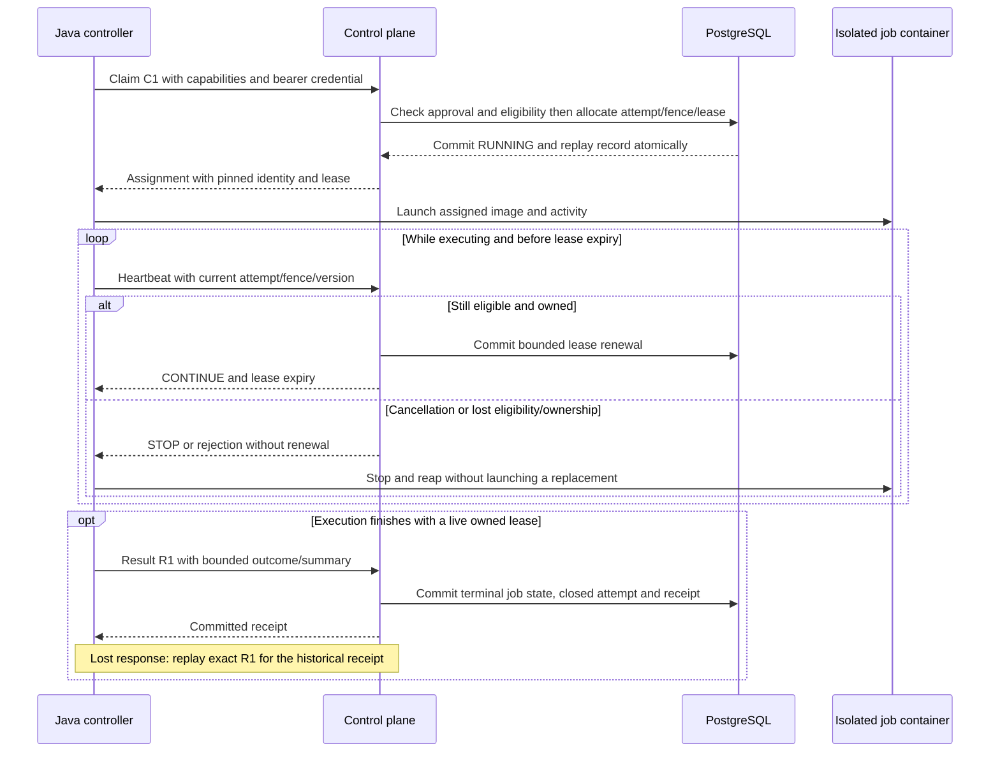
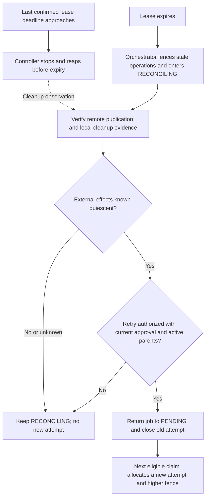

# Single-worker protocol v1

Contract for [#37](https://github.com/skizzay/forgeflow/issues/37), under #9/#3.
This specifies future endpoints; none are implemented by this document. Scope is
one configured Java controller, one repository and one active Docker job. Jobs
have no database/Flowable access. See [architecture](../architecture/overview.md),
[lifecycle guards](../architecture/lifecycle-states.md) and
[recovery evidence](../research/issue-18-results.md).

## Worker interaction

The controller authenticates to the control plane and owns the Docker lifecycle.
The job container receives its bounded activity input, not the controller's API
credential or Docker socket. This diagram summarizes the proposed protocol;
transaction, authority and replay rules below remain mandatory.



An empty/ineligible claim returns 204 without launching anything. Cancellation
and terminal result race under the same transaction rules; the diagram's result
path is unavailable once cancellation, ownership loss or expiry wins. With no
response, the controller stops before its last confirmed lease deadline.

## Transport and authority

Use HTTPS with JSON (`application/json`) at `/api/worker/v1`; times are UTC RFC3339,
IDs are UUIDs, versions/fences are positive signed 64-bit integers (state version
may be zero), and SHA-256 values are 64 lowercase hex characters. Reject unknown
fields, invalid enums/identifiers and bodies over 64 KiB. Never log credentials,
raw request bodies, source code or process output.

Each request carries `Authorization: Bearer <configured-secret>`. Provision one
high-entropy secret out of band, mapped server-side to one stable worker UUID.
Compare secrets in constant time, use external secret configuration, and redact
configuration output. Replacing the secret revokes the old credential without
changing worker identity. No enrollment endpoint, identity platform or JWT claim
from the worker is needed. TLS termination must preserve authentication headers
only over a trusted protected hop. No credentials go in query strings.

The principal comes from authentication, never JSON. It can operate only on its
own attempt. A known foreign attempt returns 403 without exposing its state;
unknown resources return 404. Worker credentials cannot approve plans, cancel
other work, write SCM bindings or perform human/release operations. Human job
cancellation is a separate operator command (#68).

The server derives current approval, active parents, dependencies and registered
activity from trusted records. Workers cannot choose job IDs at claim, workflows,
commands, approval identities or fences. Image availability reported by a worker
is a scheduling assertion; the trusted controller must enforce the assigned
image digest and isolation. It is not attestation or approval authority.

## Operations

| Method and path | Request | Success |
|---|---|---|
| POST `/claims` | `commandId`, `capabilities` | 200 assignment; 204 no eligible job |
| POST `/jobs/{jobId}/attempts/{attemptId}/heartbeat` | `commandId`, `fencingToken`, `stateVersion` | 200 lease/directive |
| POST `/jobs/{jobId}/attempts/{attemptId}/result` | `commandId`, `fencingToken`, `stateVersion`, `outcome`, `summary` | 200 terminal receipt |

`commandId` is a globally unique UUID for one logical operation. The request
fingerprint includes operation/path and all typed fields; object member order
is irrelevant. Authenticate/authorize before replay lookup. Same principal,
command and fingerprint replays the original committed response; changing any
input under that ID returns 409 `COMMAND_CONFLICT`. An ID cannot be reused across
operations. Persist replay identity transactionally, not in worker memory.

Never acknowledge state/result changes before commit. Retry a lost response with
the same command ID and body; use a new command ID for the next heartbeat/poll.
A completed empty poll is a cached 204, not an indefinitely reusable subscription.
503 does not prove rollback: retry the same command, never assume a new claim.

## Request examples

Synthetic IDs below illustrate complete request bodies. Authentication is supplied
separately in the header; the worker identity is never a request-body field.

```json
{"commandId":"10000000-0000-4000-8000-000000000001","capabilities":{"platform":"linux/amd64","executionImages":["example.invalid/agent@sha256:aaaaaaaaaaaaaaaaaaaaaaaaaaaaaaaaaaaaaaaaaaaaaaaaaaaaaaaaaaaaaaaa"]}}
```

```json
{"commandId":"10000000-0000-4000-8000-000000000002","fencingToken":1,"stateVersion":1}
```

```json
{"commandId":"10000000-0000-4000-8000-000000000003","fencingToken":1,"stateVersion":1,"outcome":"SUCCEEDED","summary":{"exitCode":0,"checksPassed":true}}
```

## Claim and assignment

`capabilities` has exactly `platform` (initially `linux/amd64` or `linux/arm64`)
and `executionImages` (one to eight unique, bounded OCI image references pinned
by `@sha256:` plus 64 lowercase hex characters). Only server-configured image
references are eligible. No provider/model registry or arbitrary shell input is
introduced. Future resource/network budgets are trusted image/controller settings.

Select a PENDING job whose approval/parents/dependencies are current and whose
required platform/image match. A mismatch returns 204 without allocating an
attempt or disclosing an ineligible job. Allocate attempt ID, monotonically
increasing per-job fence and lease, and transition PENDING -> RUNNING in one
transaction. Concurrent claims yield at most one active owner; a worker with a
live assignment cannot obtain another job (409 `ATTEMPT_ACTIVE`). No expired
attempt is implicitly reclaimed. A held/unknown recovery state is ineligible.

The assignment contains exactly:

- `jobId`, `attemptId`, `workerId`, `fencingToken`, `stateVersion` (RUNNING version).
- `leaseExpiresAt`, `serverTime`, `heartbeatIntervalSeconds` (10 initially).
- `approval`: `approvalId`, `planRevision`, `configurationSha256`.
- `execution`: `runId`, `workflowKey`, `workflowVersion`, `processDefinitionId`,
  `activityKey`, `activityVersion`; its approval is the assignment's approval.
- `activity`: `inputContractVersion`, `outputContractVersion`, `input` (the
  registered activity's validated, bounded JSON object), `platform`, `executionImage`.

Definition/contract versions are positive 32-bit integers. Plan revision is an
ASCII token of 1–128 characters. Workflow/activity/definition identifiers are
nonempty server-registered strings. No bearer secret, PEM, approval grant,
unbounded context or raw SCM payload is embedded in `input`. The assignment is
immutable for the attempt; the controller rejects unsupported registered input
contracts rather than interpreting arbitrary instructions as new activities.

A replayed claim rechecks current ownership, RUNNING state, live lease and current
approval/parent eligibility. If no longer executable, return 409 `ASSIGNMENT_INVALID`
instead of cached work. This exception prevents a delayed claim from launching
expired/cancelled execution. Replaying a claim never extends its lease. The
controller heartbeats before launching replayed work and never runs an attempt
concurrently with its own existing execution of that attempt.

## Heartbeat and cancellation observation

`stateVersion` is the assignment's RUNNING version; heartbeat alone does not
increment it or the fence. Only the authenticated current attempt/fence can
renew, and only while its lease and approval/parent eligibility remain valid.
Server time decides expiry: `now >= leaseExpiresAt` is expired. Renew to server
`now + 30 seconds`; no worker-selected duration or resurrection after expiry.

Return `jobId`, `attemptId`, `fencingToken`, `stateVersion`, `jobState`,
`directive` (`CONTINUE` or `STOP`), `leaseExpiresAt`, `serverTime`. A fresh
heartbeat of RUNNING work returns CONTINUE with the renewed lease. An exact
heartbeat replay returns its original expiry and never renews again. Cancellation
and ownership/eligibility loss override a cached CONTINUE; return STOP or the
corresponding 409. STOP for CANCELLED/RECONCILING does not renew a lease. Only the
current identified owner may observe that state; it is not authorization to
change it. A valid owner seeing cancellation receives 200 STOP with the current
state version even when its supplied RUNNING version is old.

On STOP, 409 or 403 the controller must stop/reap local execution and not claim a
new job until it is quiescent. On transport failure it must stop before its last
confirmed lease expires; a cached heartbeat response cannot extend that deadline.
Budget the deadline conservatively from monotonic request-send time and the
returned server-time/expiry interval; never rely on synchronized host clocks.
Cleanup confirmation and remote reconciliation belong to #45/#56. A heartbeat
or worker success assertion alone is not proof that external effects are quiescent.

## Result and replay

`outcome` is SUCCEEDED or FAILED; `summary` has exactly `exitCode` (signed 32-bit
integer) and `checksPassed` (boolean). SUCCEEDED requires zero exit code and
passing checks. This bounded worker report is not independent SCM/test authority.
Do not send logs, patches, arbitrary metrics or credentials. Artifact/commit
publication and usage reporting have their own tickets and contracts.

Require the current authenticated owner, live fence/lease, expected RUNNING
version, matching pinned identities and active approved parents. Use existing
Job guards; persist outcome/receipt and close the attempt atomically. The
receipt contains `commandId`, `jobId`, `attemptId`, `fencingToken`, `fromState`,
`toState`, `stateVersion`. A committed result replay returns that historical
receipt even after the lease has expired; it grants no new execution rights.
A new stale result returns 409 and cannot overwrite cancellation or a newer
attempt. Identical outcome under a different command ID is not a replay.

Only job state changes. Story merge requires verified GitHub evidence; workflow
activity advancement (#70) and publication (#48/#49/#71) remain separate. The
worker never chooses the next workflow step or grants approval.

## Errors and ownership of retry

Errors contain exactly `commandId` (null if missing/malformed), `code`, `action`
(`RETRY_SAME_COMMAND`, `STOP`, `FIX_REQUEST`). No internal SQL/exception text.

| HTTP | Codes | Action |
|---|---|---|
| 400 / 413 / 415 | INVALID_REQUEST / BODY_TOO_LARGE / UNSUPPORTED_MEDIA_TYPE | FIX_REQUEST |
| 401 | UNAUTHENTICATED | STOP; operator fixes/renews credentials |
| 403 / 404 | FORBIDDEN / NOT_FOUND | STOP |
| 409 | COMMAND_CONFLICT / ATTEMPT_ACTIVE | FIX_REQUEST; do not start another execution |
| 409 | STALE_FENCE / STALE_VERSION / LEASE_EXPIRED / ASSIGNMENT_INVALID / JOB_STOPPED | STOP |
| 503 | UNAVAILABLE | RETRY_SAME_COMMAND, subject to the existing lease deadline |

Do not blindly retry other 4xx responses. A controller retries transient transport
failures with the same operation ID and bounded backoff (1, 2, then 5 seconds).
It stops active work by lease expiry regardless of connectivity. The orchestrator
alone enters RECONCILING, verifies remote/local cleanup and authorizes a new
attempt/fence. Flowable retries must not bypass that policy or create another
container for an unresolved attempt. Production endpoints remain deny-by-default
until their authentication and trusted authority adapters are implemented.

## Expired-lease retry path

Lease expiry stops execution permission. It does not grant permission to claim
the same work again. The orchestrator owns the following recovery decisions;
worker cleanup reports are observations, not sufficient proof by themselves.
Reconciliation may also establish a terminal result; this diagram focuses on
whether a new attempt is permitted.



## Acceptance examples

These are normative scenarios for implementation tests, not executed HTTP tests.
Each row uses an independent fixture unless it explicitly describes a replay or race.
`C1/H1/R1` denote distinct UUID command IDs; `J/A/W` denote job/attempt/worker IDs.

| Scenario | Request/observation | Required response and invariant |
|---|---|---|
| Successful claim | W sends C1 with matching platform/digest; approved J is PENDING v0 | 200: J/A/W, fence 1, RUNNING v1, registered pins/input, server lease; one attempt |
| Unsupported image | New C2 offers a different digest | 204; no allocation or state mutation |
| Unauthorized worker | Claim without valid bearer | 401 UNAUTHENTICATED; no assignment |
| Foreign identity | Another principal heartbeats J/A | 403 FORBIDDEN; no renewal |
| Stale fence | H1 supplies fence 1 after fence 2 exists | 409 STALE_FENCE STOP; no state/lease mutation |
| Current heartbeat | H1 uses current A/fence/version before expiry | 200 CONTINUE; expiry now + 30s; replay H1 does not extend again |
| Cancellation | Operator cancels J before H2 | 200 STOP/CANCELLED, current version, no renewal; stop container |
| Expired assignment replay | C1 repeated after lease expiry | 409 ASSIGNMENT_INVALID; no relaunch or renewal |
| Successful result | R1 supplies current A/fence/v1, SUCCEEDED, zero exit/passing checks | 200 RUNNING -> SUCCEEDED v2; attempt closed; story/epic unchanged |
| Lost result response | Exact R1 replay after commit/restart/expiry | Same 200 receipt; one state/audit write, no execution permission |
| Conflicting replay | R1 reused with a different summary | 409 COMMAND_CONFLICT; original receipt unchanged |
| Cancel/result race | Cancellation wins transaction before new R1 | 409 JOB_STOPPED; CANCELLED remains terminal |
