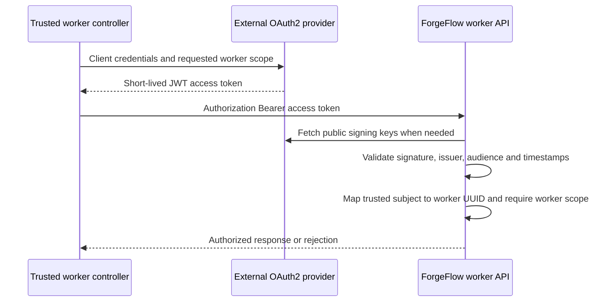

# OAuth2 worker authentication

Implementation for [#38](https://github.com/skizzay/forgeflow/issues/38).
ForgeFlow is a resource server, not an identity platform. Use an external OAuth2
provider and its client-credentials flow for the trusted worker controller. LDAP
or Active Directory integration belongs behind that provider; ForgeFlow does not
manage accounts, passwords, directories, token issuance or client enrollment.

This enables authentication for worker v1 routes only. Production claim,
heartbeat and result endpoints remain unimplemented; an authorized request to an
absent endpoint returns 404. No database worker enrollment is performed.

Configure the provider to issue RS256-signed JWT access tokens with an exact issuer,
a `sub` identifying the controller, audience `forgeflow` (or your configured
value), an expiry, and scope `forgeflow.worker`. Use access tokens, not ID tokens.
Give the controller its client credentials through an external secret store. The
control plane needs only public provider metadata and a trusted identity mapping:

| Environment variable | Purpose |
|---|---|
| `FORGEFLOW_WORKER_ENABLED` | `true` enables worker v1 access; defaults to false |
| `FORGEFLOW_WORKER_ID` | Stable, pre-provisioned ForgeFlow worker UUID |
| `SPRING_SECURITY_OAUTH2_RESOURCESERVER_JWT_ISSUERURI` | Exact trusted token issuer, e.g. `https://identity.example/realms/home` |
| `SPRING_SECURITY_OAUTH2_RESOURCESERVER_JWT_JWKSETURI` | Optional HTTPS public signing-key endpoint; otherwise discovered from issuer |
| `SPRING_SECURITY_OAUTH2_RESOURCESERVER_JWT_AUDIENCES` | Required access-token audience, e.g. `forgeflow` |
| `FORGEFLOW_WORKER_SUBJECT` | Exact trusted controller subject within this issuer |

The same provider settings can be supplied as standard Spring YAML:

```yaml
spring:
  security:
    oauth2:
      resourceserver:
        jwt:
          issuer-uri: https://identity.example/realms/home
          jwk-set-uri: https://identity.example/realms/home/protocol/openid-connect/certs
          audiences:
            - forgeflow
```

All settings except the explicit JWKS URI are required when enabled. Spring Boot
auto-configures the reactive JWT decoder from its standard resource-server
properties. ForgeFlow configures only worker identity and authorization. This deliberately supports one configured
issuer/subject-to-worker mapping, not a provisioning service. Compose requires
explicit environment forwarding (`-e VARIABLE_NAME`, without embedding secrets).



Send a single `Authorization: Bearer <access-token>` header over HTTPS, with a
protected TLS-termination hop. Spring Security validates signatures, issuer,
audience, expiry and not-before time (with its default clock skew). ForgeFlow additionally rejects tokens without an expiry. The configured
subject is mapped to a framework-free worker principal; request-body identity is
ignored. Only the worker scope is retained as an authority. No session is created.

Missing/invalid tokens or an unmapped subject return 401 with a Bearer challenge;
a mapped identity without worker scope returns 403. These are standard OAuth2
security responses, outside the protocol command-error envelope. Scope grants
access to worker routes, not permission to approve plans, perform human actions,
or access another attempt. Those contextual guards belong to future use cases.
Health and signed GitHub webhook authentication retain their existing behavior.

The controller renews access tokens at the provider. Rotate its client secret
there; no API shared-secret setting exists. JWTs already issued can remain valid
until expiry (plus clock skew); disabling a client does not immediately revoke
locally validated tokens. Use short token lifetimes and provider signing-key
rotation. Changing the mapping requires restarting all control-plane instances.
Never pass controller credentials or access tokens into untrusted job containers,
Git, URLs or logs. Deploy and operate the provider separately.

Reactive security tests load Boot's actual resource-server auto-configuration and use real RSA-signed tokens and a local public JWKS endpoint
to verify identity binding, signature/issuer/audience/expiry rejection, required
scope, route isolation, disabled configuration and session absence. Test-only
probe routes are not production endpoints. These tests do not establish live IdP,
LDAP/AD federation, TLS deployment or operational key-rotation behavior. Run the
full regression suite with `./scripts/verify-bootstrap.sh` from the repository root.

The implementation uses [Spring Security's reactive JWT resource server](https://docs.spring.io/spring-security/reference/7.0/reactive/oauth2/resource-server/jwt.html).
